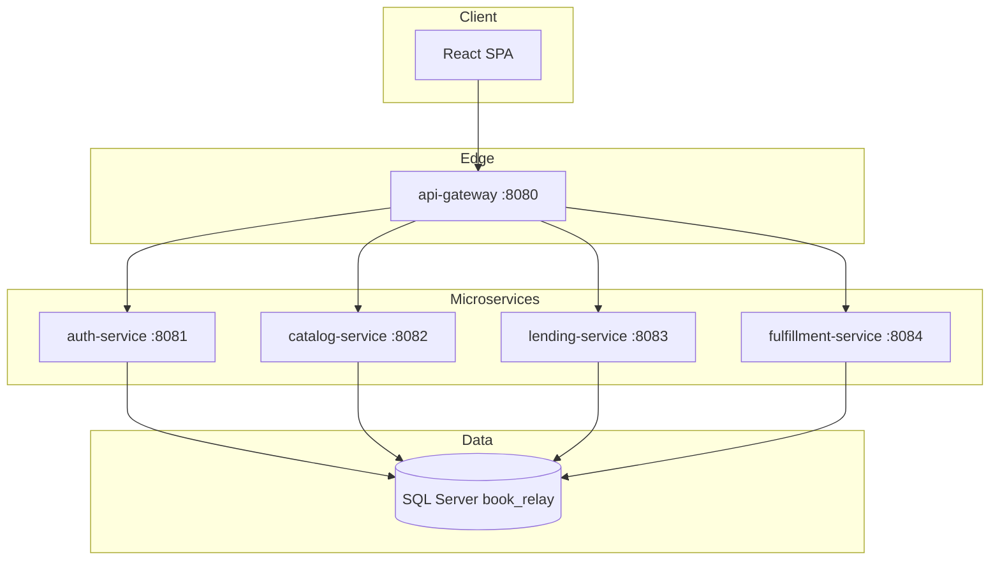
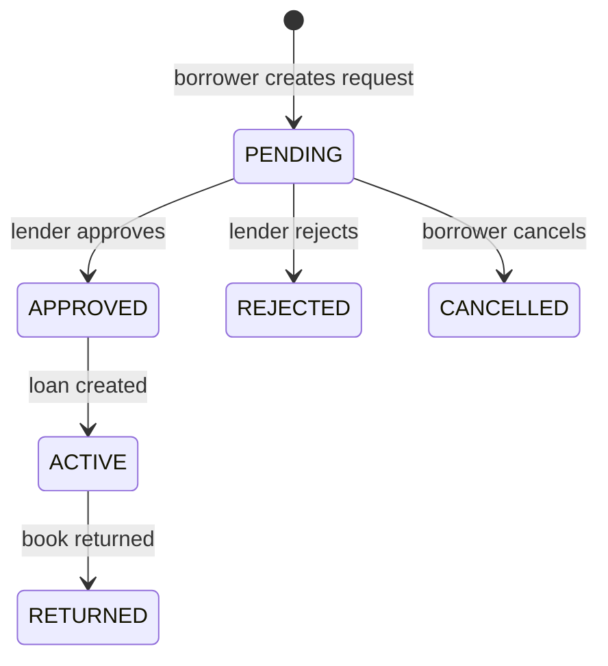

# Book Relay — Microservices Platform Plan

## Goals

- Any user can **register**, **list books** they own, and **request to borrow** books listed by others.
- After a borrow is **approved**, lender and borrower coordinate **in-person meetup** (when nearby) or **mailing**.
- **React** UI, **Spring Boot** microservices, **SQL Server** with **JPA/Hibernate** (`ddl-auto=update`) so tables are created/updated on service startup.
- **Shared database** (your choice): one database `book_relay`, **separate SQL Server schemas** per service for isolation without multiple DB instances.

## High-level architecture



**Inter-service rule:** no cross-schema JPA relationships. Services store foreign keys as plain `UUID`/`BIGINT` (e.g. `owner_id`, `book_id`) and validate via REST calls or gateway-passed JWT claims. This keeps each service deployable even though the DB is shared.

## Repository layout (monorepo)

```
book-relay/
├── frontend/                 # React + Vite + TypeScript
├── services/
│   ├── api-gateway/
│   ├── auth-service/
│   ├── catalog-service/
│   ├── lending-service/
│   └── fulfillment-service/
├── docker-compose.yml        # SQL Server + optional local run
└── README.md
```

Each service is an independent Maven module (`pom.xml`, own `src/main/java`, own `application.yml`).

## SQL Server + JPA table creation

| Setting | Value |
|---------|--------|
| Database | `book_relay` |
| Schemas | `auth`, `catalog`, `lending`, `fulfillment` |
| DDL | `spring.jpa.hibernate.ddl-auto=update` on every service |
| Dialect | `org.hibernate.dialect.SQLServerDialect` |
| Schema binding | `spring.jpa.properties.hibernate.default_schema=<service_schema>` |

**Shared DB discipline**

- Each service owns **only** tables in its schema.
- Table names are simple (`users`, `books`, `borrow_requests`) because schemas already namespace them.
- On first deploy, start services in any order; Hibernate creates missing tables per schema.
- Use **Flyway/Liquibase later** for production migrations; v1 relies on Hibernate as you requested.

Example `application.yml` fragment (auth-service):

```yaml
spring:
  datasource:
    url: jdbc:sqlserver://localhost:1433;databaseName=book_relay;encrypt=true;trustServerCertificate=true
    username: ${DB_USER}
    password: ${DB_PASSWORD}
  jpa:
    hibernate:
      ddl-auto: update
    properties:
      hibernate:
        default_schema: auth
```

## Microservices (5 deployables)

### 1. `api-gateway` (Spring Cloud Gateway)

- Single public entry: `http://localhost:8080`
- Routes (strip prefix before forwarding):

| Public path | Target |
|-------------|--------|
| `/api/auth/**` | `auth-service` |
| `/api/books/**` | `catalog-service` |
| `/api/borrows/**` | `lending-service` |
| `/api/fulfillment/**` | `fulfillment-service` |

- Validates JWT on protected routes (filter reads `Authorization: Bearer`, calls auth introspection or local JWT verification with shared secret).
- Adds headers for downstream: `X-User-Id`, `X-User-Email` (from JWT claims).

### 2. `auth-service` — schema `auth`

**Responsibilities:** registration, login, JWT issue, profile + addresses (needed for proximity and mailing).

**JPA entities**

| Entity | Key fields |
|--------|------------|
| `User` | `id`, `email` (unique), `passwordHash`, `displayName`, `phone`, `createdAt` |
| `UserAddress` | `id`, `userId`, `label`, `line1`, `line2`, `city`, `state`, `postalCode`, `country`, `latitude`, `longitude`, `isDefault` |

**APIs**

- `POST /api/auth/register` — email, password, displayName
- `POST /api/auth/login` — returns `{ accessToken, expiresIn }`
- `GET /api/auth/me` — current user profile
- `PUT /api/auth/me` — update profile
- `GET/POST/PUT/DELETE /api/auth/addresses` — CRUD addresses

**Security:** Spring Security 6, BCrypt passwords, JWT (HS256, secret in env). No social login in v1; keep `OAuth2Client` dependency out until phase 2.

### 3. `catalog-service` — schema `catalog`

**Responsibilities:** owners list books; borrowers browse/search.

**JPA entities**

| Entity | Key fields |
|--------|------------|
| `BookListing` | `id`, `ownerId`, `title`, `author`, `isbn`, `description`, `condition` (enum), `coverImageUrl`, `status` (`AVAILABLE`, `BORROWED`, `UNLISTED`), `createdAt`, `updatedAt` |

**APIs**

- `GET /api/books` — public browse (filters: `title`, `author`, `ownerCity` via optional join to auth — v1: filter by `ownerId` + client shows distance later; or catalog caches `ownerPostalCode` denormalized on listing for simple proximity filter)
- `GET /api/books/{id}`
- `POST /api/books` — create listing (auth required, `ownerId` from JWT)
- `PUT /api/books/{id}` — owner only
- `DELETE /api/books/{id}` — soft-unlist (`UNLISTED`)
- `PATCH /api/books/{id}/status` — internal/lending callback to set `BORROWED` / `AVAILABLE`

**Denormalization (recommended for shared DB simplicity):** store `ownerDisplayName` and `ownerPostalCode` on `BookListing` at create/update time (updated via event or sync REST call to auth) so browse does not require cross-service joins at query time.

### 4. `lending-service` — schema `lending`

**Responsibilities:** borrow request workflow and active loan lifecycle.

**JPA entities**

| Entity | Key fields |
|--------|------------|
| `BorrowRequest` | `id`, `bookId`, `borrowerId`, `lenderId`, `message`, `status` (`PENDING`, `APPROVED`, `REJECTED`, `CANCELLED`), `createdAt` |
| `Loan` | `id`, `borrowRequestId`, `bookId`, `borrowerId`, `lenderId`, `status` (`ACTIVE`, `RETURNED`, `OVERDUE`), `borrowedAt`, `dueAt`, `returnedAt` |

**State machine**



**APIs**

- `POST /api/borrows/requests` — `{ bookId, message }` (borrower)
- `GET /api/borrows/requests/incoming` — lender inbox
- `GET /api/borrows/requests/outgoing` — borrower sent
- `POST /api/borrows/requests/{id}/approve` — lender; calls catalog to mark book `BORROWED`, creates `Loan`, triggers fulfillment draft
- `POST /api/borrows/requests/{id}/reject`
- `POST /api/borrows/requests/{id}/cancel`
- `GET /api/borrows/loans` — my active/history
- `POST /api/borrows/loans/{id}/return` — marks `RETURNED`, catalog back to `AVAILABLE`

**Cross-service calls (sync REST, v1)**

- On approve: `PATCH catalog-service` book status.
- On return: same in reverse.
- On approve: `POST fulfillment-service` create fulfillment record.

### 5. `fulfillment-service` — schema `fulfillment`

**Responsibilities:** meetup vs mail after loan is active.

**JPA entities**

| Entity | Key fields |
|--------|------------|
| `Fulfillment` | `id`, `loanId`, `type` (`MEETUP`, `MAIL`), `status` (`DRAFT`, `PROPOSED`, `CONFIRMED`, `IN_TRANSIT`, `COMPLETED`), `createdAt` |
| `MeetupPlan` | `fulfillmentId`, `proposedLocation`, `proposedAt`, `confirmedAt`, `notes` |
| `ShipmentPlan` | `fulfillmentId`, `shipFromAddressId`, `shipToAddressId`, `carrier`, `trackingNumber`, `shippedAt`, `deliveredAt` |

**APIs**

- `POST /api/fulfillment` — create for `loanId` + `type` (borrower or lender)
- `GET /api/fulfillment/loan/{loanId}`
- `PUT /api/fulfillment/{id}/meetup` — propose/confirm meetup details
- `PUT /api/fulfillment/{id}/shipment` — enter carrier + tracking
- `PATCH /api/fulfillment/{id}/status` — progress workflow

**Proximity (v1, simple):** React computes rough distance from lat/lng on addresses (Haversine in UI). If distance &lt; configurable threshold (e.g. 25 km), UI suggests **Meetup**; otherwise **Mail**. No separate geo microservice in v1.

## React frontend (`frontend/`)

**Stack:** Vite, React 18, TypeScript, React Router, TanStack Query, Axios (base URL `http://localhost:8080`), lightweight UI (Tailwind + headless components or MUI — pick one and stay consistent).

**Pages / routes**

| Route | Purpose |
|-------|---------|
| `/register`, `/login` | Auth |
| `/` | Browse available books (cards, search) |
| `/books/:id` | Detail + “Request to borrow” |
| `/my/listings` | Owner CRUD for books |
| `/my/requests` | Outgoing borrow requests |
| `/my/inbox` | Incoming requests (approve/reject) |
| `/my/loans` | Active loans + return action |
| `/my/loans/:id/fulfillment` | Choose meetup vs mail, enter details |
| `/profile` | Profile + addresses |

**Auth flow:** store JWT in memory + `sessionStorage`; Axios interceptor attaches Bearer token; redirect to `/login` on 401.

**Key UI flows**

1. Register → login → add address in profile.
2. List a book → appears on browse with `AVAILABLE`.
3. Another user requests borrow → lender approves → book `BORROWED`, loan `ACTIVE`.
4. Fulfillment page: meetup (location + time) or mail (confirm addresses, tracking).
5. Return book → loan `RETURNED`, listing `AVAILABLE` again.

## JWT + gateway security (email/password v1)

- `auth-service` signs JWT with claims: `sub` (userId), `email`, `roles` (`USER`).
- `api-gateway` validates signature with shared `JWT_SECRET`.
- Downstream services trust `X-User-Id` only from gateway (disable direct public access to service ports in production).

## Local development

`docker-compose.yml`:

- `mcr.microsoft.com/mssql/server:2022-latest` with `SA_PASSWORD`, port `1433`
- Optional: build/run each Spring service (or run from IDE)

**Startup order (practical):** SQL Server → auth → catalog → lending → fulfillment → gateway → `npm run dev` for React.

## Implementation phases

### Phase 1 — Foundation (MVP)

- Monorepo scaffold, SQL Server docker, shared `book_relay` DB with 4 schemas
- auth-service + gateway JWT
- catalog-service (list/browse books)
- lending-service (request/approve/loan/return)
- fulfillment-service (meetup + mail records)
- React pages for full happy path above

### Phase 2 — Hardening

- Flyway migrations per schema (replace reliance on `ddl-auto` in prod)
- Email notifications (new `notification-service` or integrate SendGrid in lending)
- Google OAuth hooks in auth-service
- Rate limiting and CORS lockdown on gateway
- Azure SQL / App Service or AKS deployment manifests

## Key technical defaults

| Topic | Choice |
|-------|--------|
| Java | 21 |
| Spring Boot | 3.3.x |
| Gateway | Spring Cloud Gateway 2023.0.x |
| IDs | `UUID` for all primary keys |
| Passwords | BCrypt |
| API style | REST + JSON |
| Errors | RFC 7807 `ProblemDetail` via `@ControllerAdvice` in each service |

## Risks and mitigations

| Risk | Mitigation |
|------|------------|
| Hibernate `ddl-auto=update` in production | Accept for dev; document switch to Flyway before prod |
| Shared DB coupling | Strict schema ownership; no cross-schema JPA; IDs only |
| Partial failure on approve (catalog updated, loan not) | Use **outbox pattern** or simple **compensating transaction**: lending approves in `@Transactional` then calls catalog; on catalog failure, roll back lending status |
| Duplicate borrow requests | Unique constraint on `(book_id, borrower_id)` where status = `PENDING` |

## What you will get after Phase 1

- Deployable **5 Spring Boot jars** + **1 React build** talking through **one gateway**
- **SQL Server tables auto-created** under schemas `auth`, `catalog`, `lending`, `fulfillment` on first run
- End-to-end flow: register → list book → request → approve → meetup/mail tracking → return
